<picture><source media="(prefers-color-scheme: dark) and (max-width: 600px)" srcset="assets/hero-phone-dark.svg"><source media="(max-width: 600px)" srcset="assets/hero-phone-light.svg"><source media="(prefers-color-scheme: dark)" srcset="assets/hero-dark.svg"></picture>

<picture><source media="(prefers-color-scheme: dark) and (max-width: 600px)" srcset="assets/label-stack-phone-dark.svg"><source media="(max-width: 600px)" srcset="assets/label-stack-phone-light.svg"><source media="(prefers-color-scheme: dark)" srcset="assets/label-stack-dark.svg"></picture> <picture><source media="(prefers-color-scheme: dark) and (max-width: 600px)" srcset="assets/stack-phone-dark.svg"><source media="(max-width: 600px)" srcset="assets/stack-phone-light.svg"><source media="(prefers-color-scheme: dark)" srcset="assets/stack-dark.svg"></picture>

<picture><source media="(prefers-color-scheme: dark) and (max-width: 600px)" srcset="assets/label-activity-phone-dark.svg"><source media="(max-width: 600px)" srcset="assets/label-activity-phone-light.svg"><source media="(prefers-color-scheme: dark)" srcset="assets/label-activity-dark.svg"></picture> <picture><source media="(prefers-color-scheme: dark) and (max-width: 600px)" srcset="assets/activity-phone-dark.svg"><source media="(max-width: 600px)" srcset="assets/activity-phone-light.svg"><source media="(prefers-color-scheme: dark)" srcset="assets/activity-dark.svg"></picture>

<picture><source media="(prefers-color-scheme: dark) and (max-width: 600px)" srcset="assets/label-rhythm-phone-dark.svg"><source media="(max-width: 600px)" srcset="assets/label-rhythm-phone-light.svg"><source media="(prefers-color-scheme: dark)" srcset="assets/label-rhythm-dark.svg"></picture> <picture><source media="(prefers-color-scheme: dark) and (max-width: 600px)" srcset="assets/rhythm-phone-dark.svg"><source media="(max-width: 600px)" srcset="assets/rhythm-phone-light.svg"><source media="(prefers-color-scheme: dark)" srcset="assets/rhythm-dark.svg"></picture>

<picture><source media="(prefers-color-scheme: dark) and (max-width: 600px)" srcset="assets/label-projects-phone-dark.svg"><source media="(max-width: 600px)" srcset="assets/label-projects-phone-light.svg"><source media="(prefers-color-scheme: dark)" srcset="assets/label-projects-dark.svg"></picture>

<a href="https://github.com/musss2003/techstars"><picture><source media="(prefers-color-scheme: dark)" srcset="assets/project-techstars-dark.svg"></picture></a>
<a href="https://github.com/musss2003/price-predictor-app"><picture><source media="(prefers-color-scheme: dark)" srcset="assets/project-price-predictor-app-dark.svg"></picture></a>
<a href="https://github.com/musss2003/chat-app-client"><picture><source media="(prefers-color-scheme: dark)" srcset="assets/project-chat-app-dark.svg"></picture></a>
<a href="https://github.com/musss2003/iot-smart-light"><picture><source media="(prefers-color-scheme: dark)" srcset="assets/project-iot-smart-light-dark.svg"></picture></a>

