<picture><source media="(prefers-color-scheme: dark)" srcset="assets/hero-dark.svg"></picture>

<picture><source media="(prefers-color-scheme: dark)" srcset="assets/about-dark.svg"></picture>

<picture><source media="(prefers-color-scheme: dark)" srcset="assets/stack-dark.svg"></picture>

<picture><source media="(prefers-color-scheme: dark)" srcset="assets/label-projects-dark.svg"></picture>

<a href="https://github.com/musss2003/techstars"><picture><source media="(prefers-color-scheme: dark)" srcset="assets/project-techstars-dark.svg"></picture></a>
<a href="https://github.com/musss2003/price-predictor-app"><picture><source media="(prefers-color-scheme: dark)" srcset="assets/project-price-predictor-app-dark.svg"></picture></a>
<a href="https://github.com/musss2003/chat-app-client"><picture><source media="(prefers-color-scheme: dark)" srcset="assets/project-chat-app-dark.svg"></picture></a>
<a href="https://github.com/musss2003/iot-smart-light"><picture><source media="(prefers-color-scheme: dark)" srcset="assets/project-iot-smart-light-dark.svg"></picture></a>

<picture><source media="(prefers-color-scheme: dark)" srcset="assets/label-activity-dark.svg"></picture>

<picture><source media="(prefers-color-scheme: dark)" srcset="assets/stats-dark.svg"></picture>

<picture><source media="(prefers-color-scheme: dark)" srcset="assets/heatmap-dark.svg"></picture>

<picture><source media="(prefers-color-scheme: dark)" srcset="assets/line-dark.svg"></picture>

Every card here is drawn by my own script · activity counted from my git history, including private work · redrawn daily

